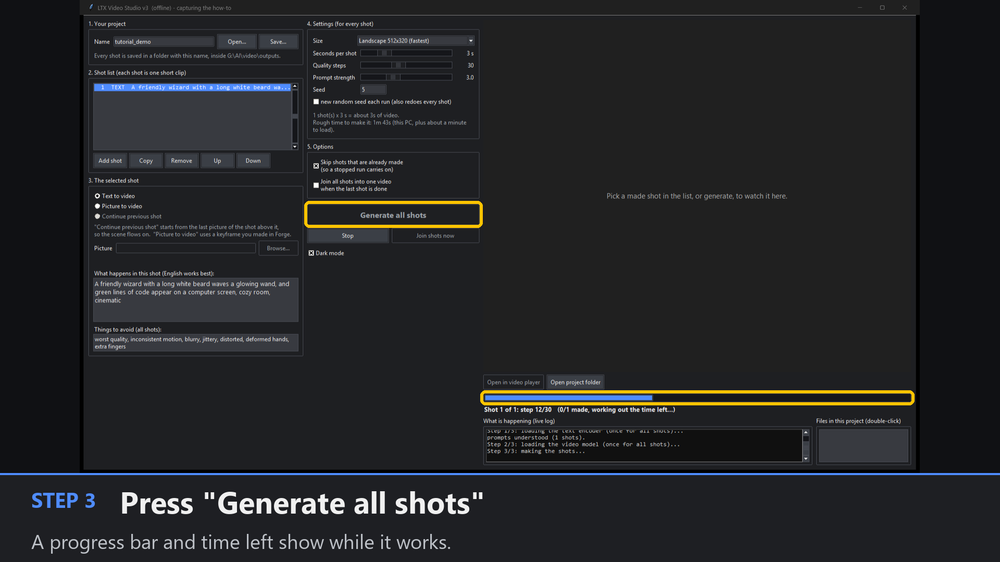
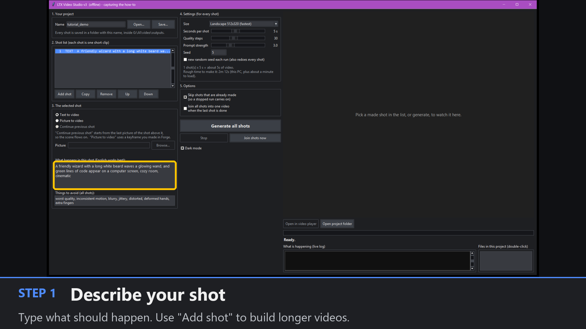
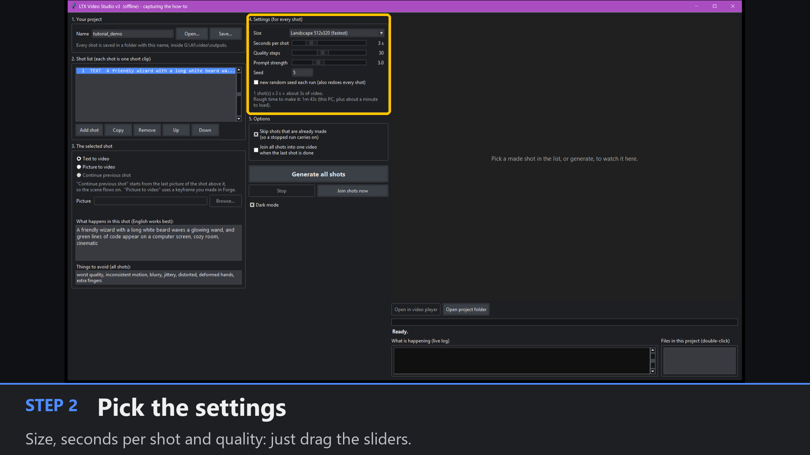
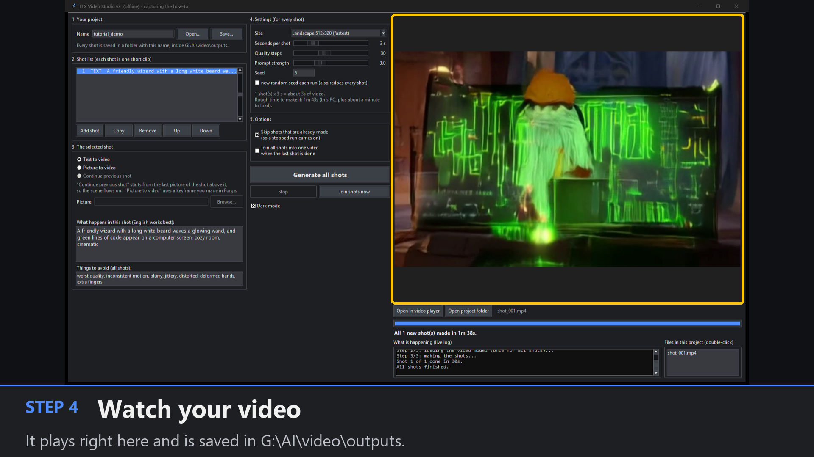

# LTX Video Studio

Make AI videos **completely offline** on your own Windows PC, from a text description or from a picture. Build long
videos by chaining many short shots together. No account, no cloud, no subscription.

It is a simple desktop window around the open [LTX-Video 2B](https://huggingface.co/Lightricks/LTX-Video) model.
**The program sets itself up**: on the first start it builds its own Python environment and downloads the models
(about 10.6 GB) with a progress bar, then you can disconnect from the internet.



## What it does

- **Text to video** - describe a scene, get a short clip.
- **Picture to video** - animate a picture you made (for example in Stable Diffusion).
- **Continue previous shot** - starts the next shot from the last picture of the one before, so scenes flow on.
- **Shot list** - add, copy, reorder shots; **Generate all shots** loads the models once and works through the list.
- **Carries on where it stopped** - finished shots are kept; change one shot and only that shot is redone (the old
  clip is moved to an `old` folder, never overwritten).
- **Join shots** into one video with a click (or automatically when the last shot is done).
- Sliders for size, seconds per shot, quality and prompt strength; dark mode; a live progress bar with time left.

## Requirements

| | |
|---|---|
| Windows | 10 or 11, 64-bit |
| Python | **3.10 or 3.11** (64-bit) from [python.org](https://www.python.org/downloads/) - tick "Add python.exe to PATH" |
| Graphics card | **NVIDIA** with CUDA. Developed and tested on an **RTX 3060 12 GB**. Less memory is untested. |
| Memory | 16 GB RAM (close other heavy programs while it runs) |
| Disk space | about 15 GB free (10.6 GB models + 2.4 GB PyTorch + your videos) |
| Internet | only for the first-time setup (about 13 GB of downloads) |

## Install and start

1. Download this repository (green **Code** button -> **Download ZIP**) and unzip it somewhere with enough space.
2. Double-click **`Start LTX Video Studio.bat`**.
3. **First start only:** a setup window builds the program's private Python environment (this installs PyTorch,
   about 2.4 GB, and takes a while - it tells you what it is doing). When it finishes, the program starts by itself.
4. In the program, press **Download the models now** (the bar at the top). Progress, speed and time left are shown.
   You can **Pause** and **Resume**, close the program, or lose your connection: it carries on from the partly
   downloaded file. When it is done the bar disappears.
5. Press **Generate all shots**.

Nothing else on your PC is changed: everything lives in this folder (`.venv`, `models`, `outputs`).

## How to use it



1. **Describe your shot.** Type what should happen. Use **Add shot** to build longer videos.
2. **Pick the settings** with the sliders (size, seconds per shot, quality steps, prompt strength).
3. **Press "Generate all shots".** A progress bar and the time left show while it works.
4. **Watch your video.** It plays in the window and is saved in the `outputs` folder, in a folder named after your project.

The same four steps as a short video: [`examples/tutorial_howto_slow.mp4`](examples/tutorial_howto_slow.mp4) (16 s, readable) and
[`examples/tutorial_howto_3s.mp4`](examples/tutorial_howto_3s.mp4) (3 s). They are real screenshots of the program with captions
(recorded with the previous version, v3; the window is the same, v4 only adds the download bar at the top on first start).

| Step 2 | Step 3 | Step 4 |
|---|---|---|
|  |  |  |

### Tips for better videos

- Describe **what moves**: "flames flicker, sparkles drift upward". Use English.
- Short shots (3-6 s) are best. For a long video, make many shots rather than one long one.
- Keep a **consistent look** between shots by making a keyframe picture for each shot (e.g. in Stable Diffusion) and
  using **Picture to video**, or use **Continue previous shot**.
- Picture to video crops the picture to the chosen size, so choose a size with the same shape as your picture.
  Transparent areas of a picture become white (video cannot be transparent).
- If it runs out of memory: close other programs, pick a smaller size, or make shots shorter.
- Rough speed on an RTX 3060: about 15 s of generating for a 1-second 512x320 clip, plus about a minute to load the
  models once per run. A 20-30 minute video is hours of generating and the quality is that of a small model - expect
  soft, sometimes odd results, no sound, and characters that drift between shots.

## Files and folders

| | |
|---|---|
| `ltx_app.py` | the program (the window) |
| `ltx_batch.py` | the video engine the program runs (loads the models once, makes every shot) |
| `ltx_gen.py` | optional command-line version for one clip at a time |
| `ltx_common.py` | folders, the resumable model downloader and the Python setup |
| `models/` | the downloaded models (created on first use) |
| `outputs/` | everything you make, one folder per project |
| `projects/` | saved project files (**Save...** / **Open...**) |
| `examples/` | the tutorial videos |

Advanced: set `LTX_MODELS` to keep the models on another drive, or `LTX_HOME` to move the working folder.

### Command line (optional)

```
.venv\Scripts\python.exe ltx_gen.py --mode t2v --prompt "a candle flickering in the dark" --name candle
.venv\Scripts\python.exe ltx_gen.py --mode i2v --image "C:\pics\chest.png" --prompt "sparkles drift upward" --name chest
```

Options: `--w`/`--h` (multiples of 32), `--frames` (8 x k + 1; 25 is about 1 second), `--steps`, `--cfg`, `--seed`.

## Models and licenses

The models are **not** in this repository. The program downloads them from Hugging Face when you press the button:

| File | From | License |
|---|---|---|
| LTX-Video 2B v0.9.1 (5.7 GB) | [Lightricks/LTX-Video](https://huggingface.co/Lightricks/LTX-Video) | Lightricks' own license - read [ltx-video-2b-v0.9.1.license.txt](https://huggingface.co/Lightricks/LTX-Video/blob/main/ltx-video-2b-v0.9.1.license.txt) before using videos commercially |
| T5-XXL text encoder, fp8 (4.9 GB) | [comfyanonymous/flux_text_encoders](https://huggingface.co/comfyanonymous/flux_text_encoders) | Apache 2.0 |
| small config / tokenizer files | Lightricks/LTX-Video, diffusers/LTX-Video-0.9.1 | as the models above |

**By pressing "Download the models now" you accept those licenses.** The code in this repository is MIT licensed
(see `LICENSE`). Built on [diffusers](https://github.com/huggingface/diffusers), PyTorch and ffmpeg (via imageio-ffmpeg).

## Troubleshooting

- **"Python was not found"** - install Python 3.11 (64-bit) from python.org and tick "Add python.exe to PATH".
- **Setup says Python 3.12 / 3.9 is not supported** - install Python 3.11. PyTorch 2.1.2 (the tested version) has no
  Python 3.12 build.
- **The download stops or the internet drops** - just press Resume (or start the program again). It keeps what it has.
- **"Out of memory"** - close other programs (browsers, games), use a smaller size or shorter shots, run again with
  the same project name: finished shots are kept.
- **Antivirus blocks the setup** - the setup runs `pip` to install PyTorch and friends; allow it, or install the
  packages yourself (see `requirements.txt`).
- **Start over** - delete the `.venv` folder (and `models` if you want the models re-downloaded) and start again.

## Status

Developed and tested on one machine (Windows, RTX 3060 12 GB, 16 GB RAM, Python 3.10/3.11). Other GPUs, systems and
long (dozens of shots) projects are untested - bug reports welcome in the Issues tab.
